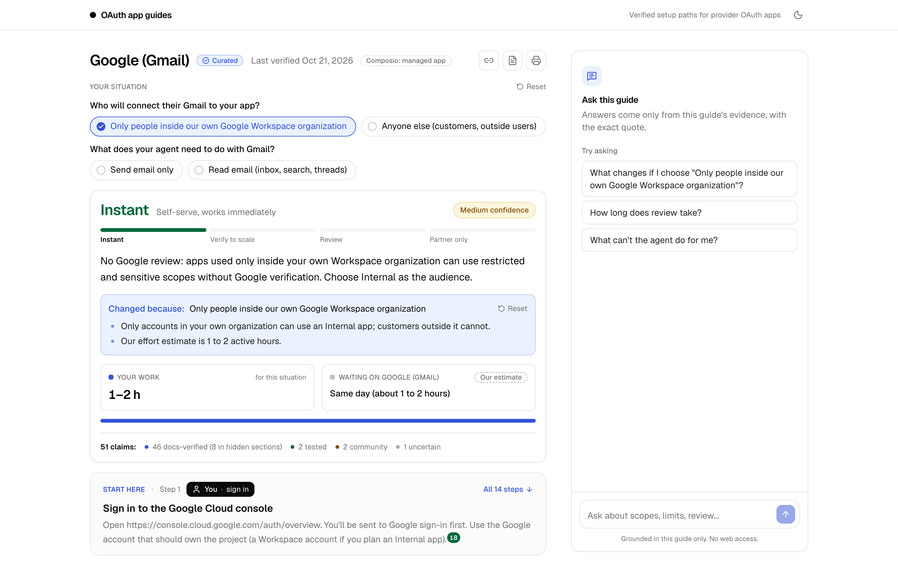
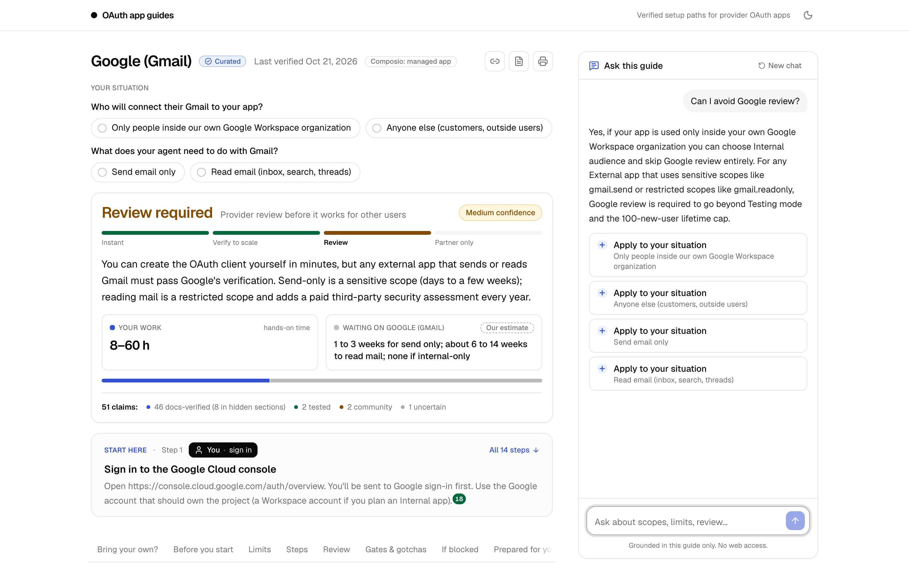
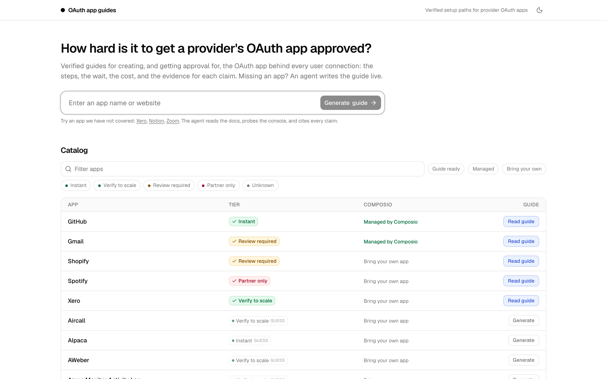
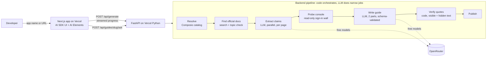

# OAuth App Guides

**Verified setup and approval paths for the OAuth apps your AI agent depends on.** Built for the Composio take-home.

| | |
|---|---|
| **Live app** | https://oauth-guides-web.vercel.app |
| **API** | https://oauth-guides-api.vercel.app/api/health |
| **Source** | https://github.com/yb0203/oauth-app-guides |
| **Verification report** | [`docs/VERIFICATION.md`](docs/VERIFICATION.md) · eval scores in [`evals/RESULTS.md`](evals/RESULTS.md) |



## A five-minute tour

1. **Open a curated guide:** [Gmail](https://oauth-guides-web.vercel.app/guides/google-gmail). Under "Your situation", pick *Only people inside our own Google Workspace* and the verdict flips from **Review required** to **Instant**. Pick *Outside users* and *Read email* and it becomes review plus a paid security assessment. The URL keeps your choices, so a shared link keeps the decision.
2. **Hover a citation** (the small numbered markers). Each one shows the exact quote, whether it was found in a collapsed section of the page, its evidence label, and the source.
3. **Ask the guide:** "Can I avoid Google review?" The answer comes only from this guide's verified evidence, and **Apply** sets your situation for you.
4. **Generate a guide for an app we never researched:** type it on the [home page](https://oauth-guides-web.vercel.app), for example *Asana*, *Zoom* or *Dropbox*. You watch the agent resolve the app, find the provider's official docs, extract claims, probe the developer console, write the guide, and then **re-check every quote on the live page** before publishing. It takes about 1 to 1.5 minutes on free models.
5. **Compare the tiers:** [GitHub](https://oauth-guides-web.vercel.app/guides/github) (instant) · [Xero](https://oauth-guides-web.vercel.app/guides/xero) (verify to scale) · [Shopify](https://oauth-guides-web.vercel.app/guides/shopify) (review required) · [Spotify](https://oauth-guides-web.vercel.app/guides/spotify) (partner only).

## The problem, as we understood it

Every user connection an agent makes (someone's Gmail, Xero or Shopify) runs through a **provider OAuth app**: the client registration the developer creates at the provider. Composio supplies a managed one for 123 toolkits. For the other 211, and whenever a developer wants their own branding, rate limits or scopes, the developer has to **register their own app and often get it approved**.

That's where developers get stuck. The answer depends on their situation (internal or external users, which scopes they need), on a reviewer's queue they don't control, and on rules that changed several times in 2026. When we asked a model from memory, it was wrong on several of these points (Spotify's user cap, GitHub's token default, which tier each app is in). So this product isn't "write a guide". It's **a research and verification process whose output is a guide**, built around four questions: *how hard is it, how long will it take, what do I need, and what can the agent do vs. what must I do?*

## What a guide contains

- **Verdict:** a difficulty tier on a four-step ladder, your hands-on hours vs. the provider's wait, and confidence. Driven by "Your situation" toggles.
- **Steps:** each says who does it (*you*, with the reason, such as sign-in, legal acceptance or submit; the *agent*; or *either*). Values like Composio's callback URL have copy buttons, and steps you can't undo carry a warning first.
- **Review and approval:** what triggers it, what to submit, the official wait vs. the community-reported wait, and the cost.
- **Limits, customer-side gates, gotchas, "when you're blocked"** (symptom → cause → fix), and **prepared for you** (minimum scopes with a justification for each, consent-screen values, a privacy-policy outline).
- **Console probe:** what the provider's developer console actually asks for (tested, read-only).
- **Sources and evidence summary**, for example "51 claims: 46 docs-verified (8 in hidden sections), 2 tested, 2 community, 1 uncertain".

| Ask this guide | Home and catalog |
|---|---|
|  |  |

## Evidence model: the core decision

| Label | Meaning |
|---|---|
| **TESTED** | Observed by our own tooling during the run (for example the sign-in wall) |
| **DOCS** | From the provider's official docs, with the **exact quote re-found on the live page** |
| **COMMUNITY** | From third-party pages (forums, blogs, integration vendors) |
| **UNCERTAIN** | Not verified. Shown, never quietly omitted |

- Quotes are checked **in code, not by a model**. The checker normalizes whitespace, case and curly quotes, and searches the page's visible **and hidden** text. Google keeps its user limits in collapsed sections, and a visible-text-only checker gave us false "not found" results.
- A quote that can't be re-found is downgraded to UNCERTAIN. Conflicting docs are shown side by side (Xero's docs say 5 uncertified apps per organisation on one page and 2 on another).
- DOCS requires the provider's own domain (including its subdomains, such as developers.google.com and support.google.com). Everything else is COMMUNITY.

## How it works



- **Code does everything a model doesn't need to:** search, fetching (plain HTTP first, with a browser fallback where Chromium exists), the console probe, quote verification, evidence labeling, tier rules and schema validation. The LLM does two narrow jobs, extracting claims from a page and writing the guide, and its output is validated and retried, with a fallback model and then a clearly labeled fallback draft.
- **Streaming:** the backend speaks the AI SDK UI message stream protocol (custom `data-stage`, `data-wall`, `data-verification` and `data-guide` parts, plus `source-url` parts), with heartbeats so long runs aren't dropped. The contract is in [`docs/CONTRACT.md`](docs/CONTRACT.md).
- **Ask this guide** is retrieval over one guide's evidence objects. The model answers with citation markers, the backend drops any citation that doesn't resolve to real evidence, and a deterministic fallback answers if the model is slow.

## How we used agents

1. **Research:** Claude Code sessions with parallel subagents researched 10 providers against official docs. A **separate verification pass** re-opened 28 pages and checked about 75 quotes, and fixed one wrong citation ([`research/`](research/)).
2. **The setup attempt as an experiment:** agents tried to set up OAuth apps themselves with a read-only browser on 5 apps. **Every console stopped at sign-in after one redirect**, and everything after that (terms, Register, payment, review) is human-only. So the product doesn't pretend an agent can create the app. It probes the wall, does the research, drafts the materials, and hands over clearly at the human steps ([`experiments/oauth-capture-poc/`](experiments/oauth-capture-poc/)).
3. **The product's agent:** the pipeline above, with free models only.
4. **Building it:** an orchestrator session plus backend and frontend sessions working in parallel against one contract. Every change was reviewed in the browser and scored against an answer key ([`evals/`](evals/)).

## What we verified, and what we couldn't

Full details are in [`docs/VERIFICATION.md`](docs/VERIFICATION.md).

| Check | Result |
|---|---|
| Independent re-check of the research quotes | about 75 across 10 providers; 1 wrong citation fixed; contradictions inside the docs kept as conflicts |
| Setup-attempt experiment (5 apps) | All 5 blocked at sign-in → design changed; 68 of 68 quotes verified, plus 8 of 8 in a re-check; 1 false negative found (hidden text) → checker fixed |
| Curated guides (5) | Every DOCS quote re-checked live (`data/guides/_quote_checks.md`, 247 checks); all validate against [`data/schema/guide.schema.json`](data/schema/guide.schema.json) |
| Live agent on production, 3 eval rounds | Tier accuracy 1.5 of 3, then 2 of 3, then **3 of 3**; mean key-fact recall 0.72; **0 inflated evidence labels in every round**; unseen apps (Todoist, Zoom, Dropbox, Asana, Calendly) produce bring-your-own guides from official docs in about 50–90 s |
| Backend tests | 346 offline unit tests and 13 live-network tests |

**Couldn't verify:** anything behind a console login (real form fields, logo limits, where secrets are generated), community-reported wait times (anecdotal), and costs with no official figure (Google CASA). Those show as UNCERTAIN or "check on first sign-in".

## Key decisions

- **Why not just a prompt?** Memory-based answers were stale or wrong. The value is live docs plus code-level verification plus structure plus Composio specifics ([`docs/SPEC.md`](docs/SPEC.md) §1 and §14).
- **Focused scope:** depth on the bring-your-own OAuth app path across 5 varied curated apps plus live generation for any app, rather than shallow coverage of 100. The 100-app candidate list is in the catalog.
- **Bring-your-own first:** even for Composio-managed apps, guides cover registering your own app. "Should you bring your own app?" explains when the managed one is enough.
- **No agent-driven setup:** the experiment showed it isn't viable, so the agent probes and prepares, and the human signs in and submits.
- **Free models only** (OpenRouter), with code doing all deterministic work. Claude Code was used to build and test, never at runtime.

## Limitations

- Generation takes about 1 to 1.5 minutes. Rarely, a run ends in a clearly labeled fallback draft rather than hanging.
- Production runs on Vercel's Python runtime, which has no Chromium. Docs that render only with JavaScript, and sign-in redirects done in JavaScript, may show as UNCERTAIN there; they work locally with Playwright installed.
- Generated guides live in the function's temporary storage, so a **permalink to a generated guide can expire** on a cold start. Curated guides are permanent.
- Free-model rate limits apply (about 20 requests per minute shared), and generations are limited to 30 per IP per 10 minutes.
- The free models sometimes miss numeric caps (Gmail's 100-user limits); curated guides include them. Every guide is true only as of its "last verified" date.

## Run it locally

```bash
# backend (Python 3.12)
cd backend && python3 -m venv .venv && .venv/bin/pip install -r requirements.txt
.venv/bin/playwright install chromium     # optional: enables the browser fallback
cp .env.example .env                      # add OPENROUTER_API_KEY (free models); LLM_MODE=fake replays a labeled demo run
.venv/bin/uvicorn app.api:app --port 8000
.venv/bin/pytest -m "not network"         # offline tests; `-m network` hits live pages

# frontend (Node 22+)
cd frontend && npm install && npm run dev  # http://localhost:3000 (NEXT_PUBLIC_API_URL defaults to http://localhost:8000)
```

**Deploy:** `scripts/deploy_backend.sh` (Vercel Python), `scripts/set_backend_env.sh` (production env; secrets are read from `backend/.env` and never printed), and `scripts/deploy_frontend.sh` (deploys from git HEAD).

## Repository map

| Path | What's there |
|---|---|
| [`docs/`](docs/) | [Spec](docs/SPEC.md), [test plan](docs/TEST_PLAN.md), [backend–frontend contract](docs/CONTRACT.md), [verification report](docs/VERIFICATION.md) |
| [`research/`](research/) | Provider research (10) and Composio auth model, catalog and prior art, each with a verification log |
| [`experiments/`](experiments/) | Setup-attempt experiment (5 apps, screenshots), plus a parked Managed Agents version |
| [`data/`](data/) | Curated guides, guide schema, live quote-check log |
| [`backend/`](backend/) | FastAPI pipeline, Ask endpoint, verifier, tests ([README](backend/README.md)) |
| [`frontend/`](frontend/) | Next.js app ([README](frontend/README.md)) |
| [`evals/`](evals/) | Scorer, saved run streams, results by round |
| [`scripts/`](scripts/) | Deploy scripts |

No credentials are in this repository.
