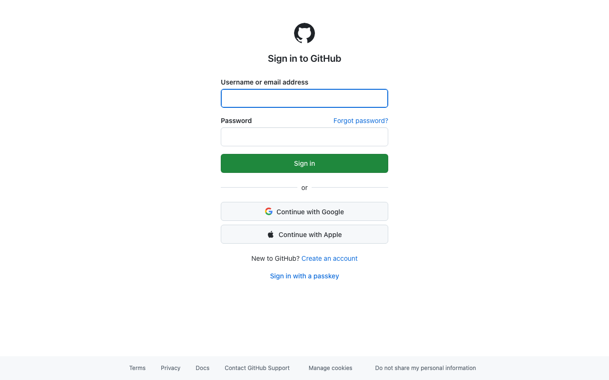
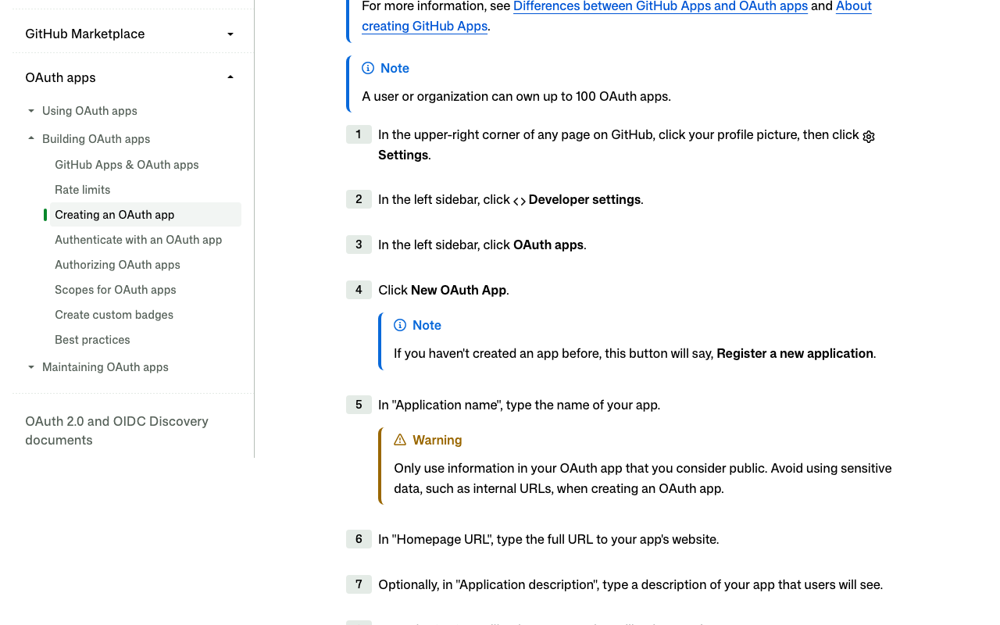
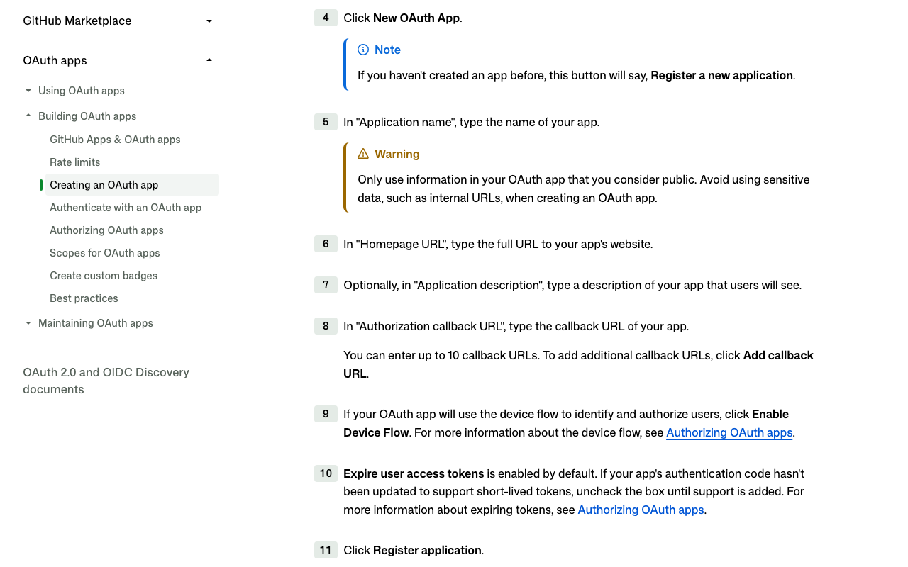

# GitHub: create an OAuth app for Composio

Captured 2026-10-21 in public mode (no sign-in). **Tier: instant.** No review, no waiting. About 5 to 10 minutes of human time.

Labels: **TESTED** = seen in the browser during this capture. **DOCS** = GitHub's docs, with the quote checked on the live page. **UNCERTAIN** = not checked in this run.

## 1. Sign in to GitHub · human (credential) · TESTED
Opening the new-app page sends you straight to GitHub's sign-in. There's no developer program or waitlist in front of it.

## 2. Open the new OAuth app form · human · DOCS
Go to Settings > Developer settings > OAuth apps > New OAuth App. After signing in, the shortcut is `https://github.com/settings/applications/new`. A user or organization can own up to 100 OAuth apps.

## 3. Fill in name, homepage and description · agent prepares, human types · DOCS
Use only information you're happy to make public.

## 4. Set the callback URL to Composio's · agent prepares, human types · DOCS
Paste `https://backend.composio.dev/api/v3/toolkits/auth/callback`, or better, the exact value shown in your Composio auth config. GitHub allows up to 10 callback URLs.

## 5. Leave "Expire user access tokens" on · DOCS
It's on by default. Composio handles the refresh for you.

## 6. Click Register application · human (submit) · DOCS
The app works immediately.

## 7. Generate a client secret and add the ID and secret to Composio · human (credential) · UNCERTAIN
This step isn't shown on the captured page, so check it when you first sign in.
