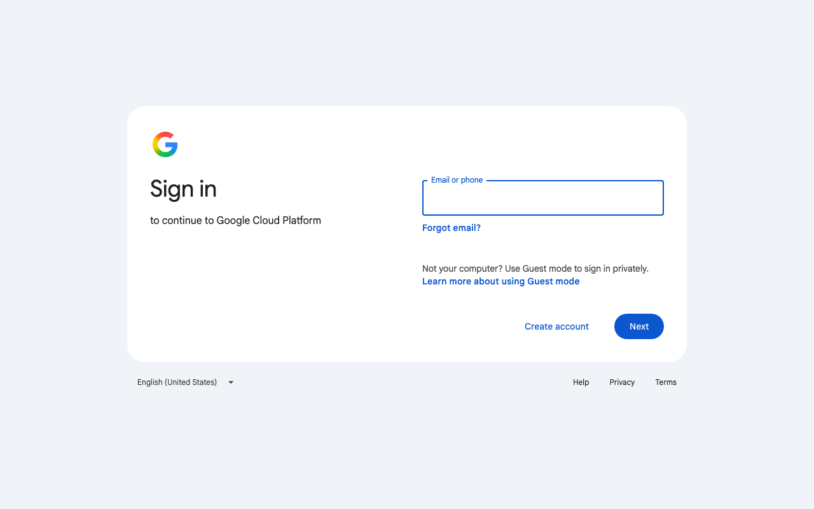
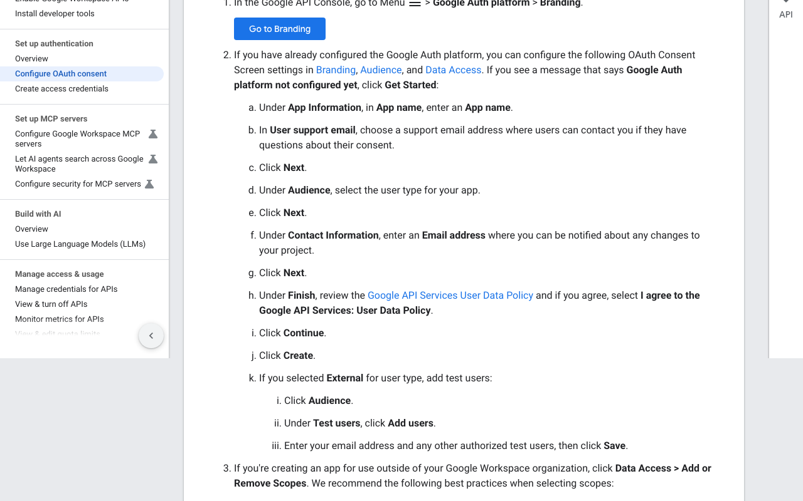
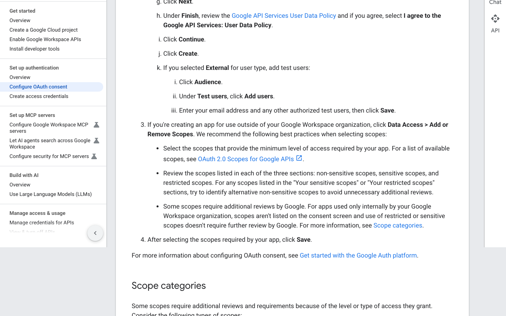
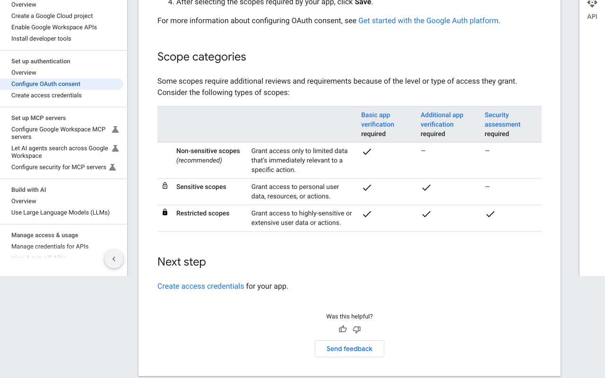
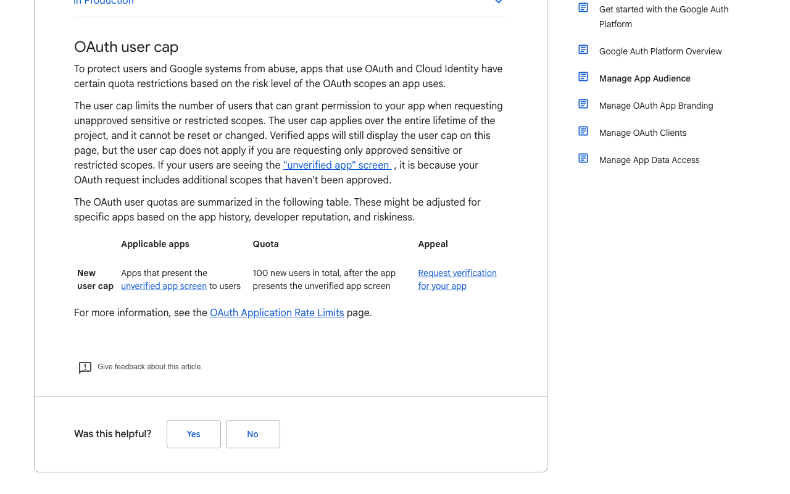
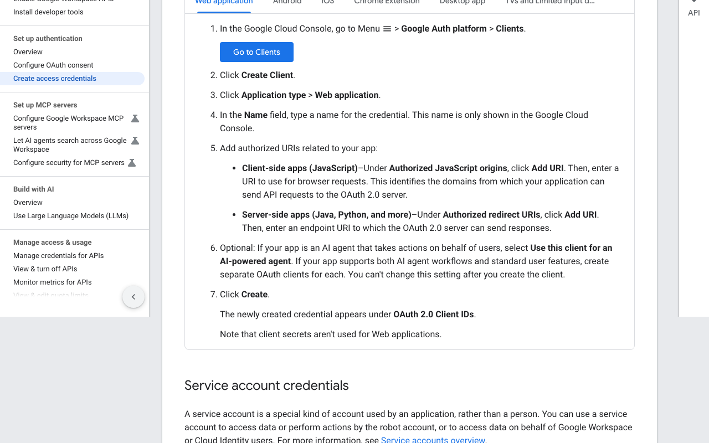

# Google: create an OAuth client for Composio (Gmail API)

Captured 2026-10-21 in public mode (no sign-in). **Tier: instant to create, but review applies later.** The client works at once for test users. Going public with sensitive or restricted Gmail scopes needs Google verification, and possibly a security assessment. About 10 to 15 minutes of human time to create the client.

Labels: **TESTED** = seen in the browser during this capture. **DOCS** = Google's docs, with the quote checked on the live page. **UNCERTAIN** = not checked in this run.

## 1. Sign in to Google Cloud · human (credential) · TESTED
The console URL redirects in one hop to Google's account sign-in. It asks for email or phone. No bot check or cookie banner appeared.

## 2. Create a project and enable the Gmail API · UNCERTAIN
Not captured. Google's docs list these as earlier steps. A first-time user may have to accept terms (a human step).

## 3. Open Google Auth platform > Branding · human · DOCS
In the console go to Google Auth platform > Branding. If it says "Google Auth platform not configured yet", click Get Started.

## 4. App name and support email · agent prepares, human types · DOCS
Enter an app name and a User support email, then Next. Google says placeholder information is fine before release.

## 5. Choose Audience: Internal or External · human decision · DOCS
The Audience step asks for the user type. The support page lists External and Internal, and a publishing status of Testing or In Production. Per the scopes section, apps used only inside your own Google Workspace organization skip further Google review. Confirm the exact Internal definition in the console.

## 6. Contact email, accept the User Data Policy, Create · human (legal acceptance) · DOCS
Enter a contact email, tick "I agree to the Google API Services: User Data Policy", click Continue, then Create. Google notes you can't remove the consent screen once it's configured.

## 7. External apps: add test users · human · DOCS
Under Audience > Test users, click Add users, enter your email and any other test users, and Save. We did not find a "100 test users" limit on the pages we read, so it is not claimed here.

## 8. Choose scopes (Data Access > Add or Remove Scopes) · either · DOCS
Pick the narrowest scopes. Google groups them as non-sensitive, sensitive and restricted. Sensitive scopes need extra app verification. Restricted scopes also need a security assessment. For internal-only apps, Google says sensitive or restricted scopes don't need further review. Which Gmail scopes fall in which group is not on these pages.

## 9. The user cap and where verification starts · DOCS
Apps that show the "unverified app" screen are limited to 100 new users in total, for the lifetime of the project, and the cap can't be reset or changed. The Audience page links "Request verification for your app" from the same table.

## 10. Create the OAuth client · human · DOCS
Go to Google Auth platform > Clients > Create Client, then set Application type to Web application and give it a name.

## 11. Add Composio's redirect URI and Create · agent prepares, human types · DOCS
Under Authorized redirect URIs, click Add URI and paste `https://backend.composio.dev/api/v3/toolkits/auth/callback`, or better, the exact value shown in your Composio auth config. Click Create.

## 12. Copy the client ID and secret into Composio · human (credential) · UNCERTAIN
Not visible without signing in. Heads-up: Google's credentials page says client secrets aren't used for Web applications, which looks odd for this flow. Check what the console shows on first sign-in.
