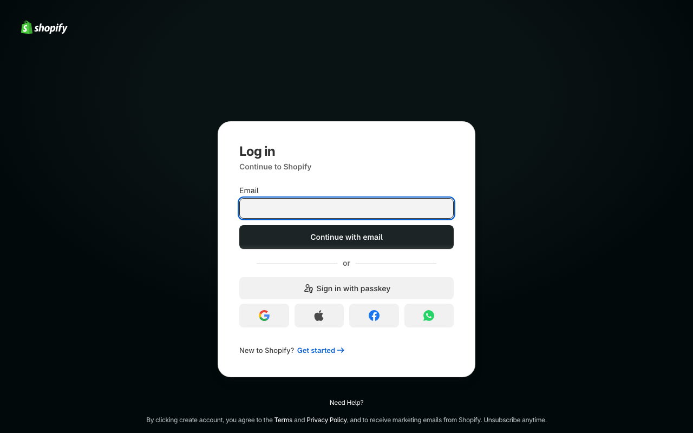
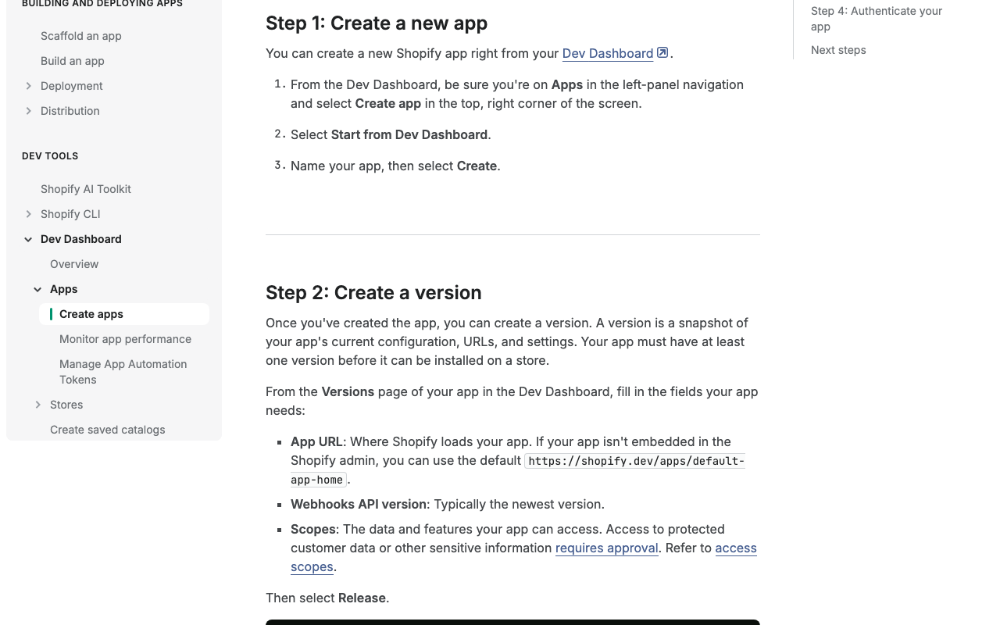
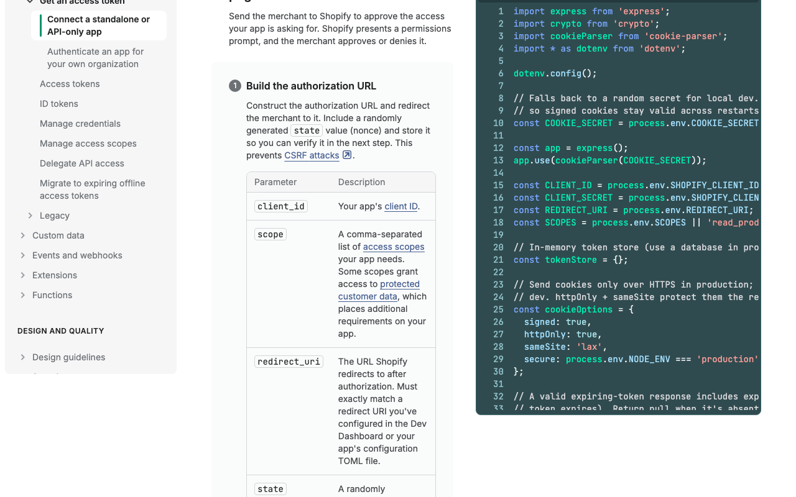
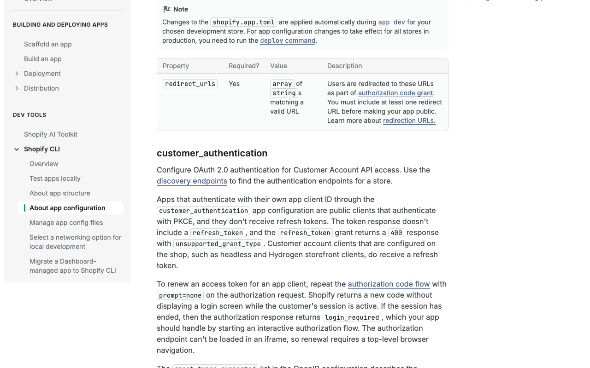
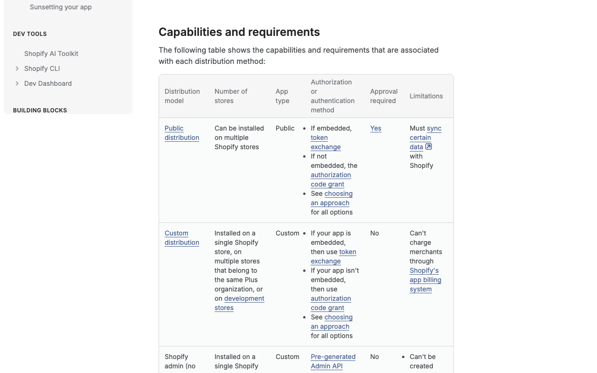
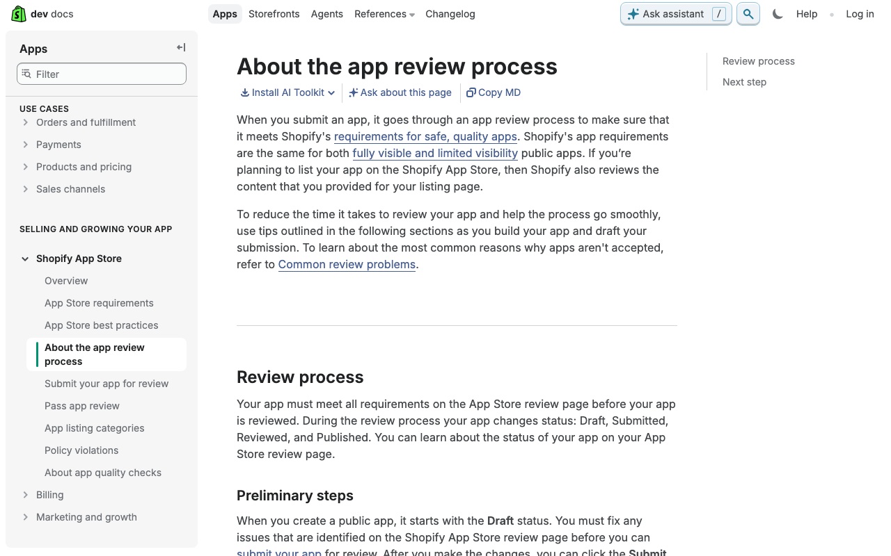
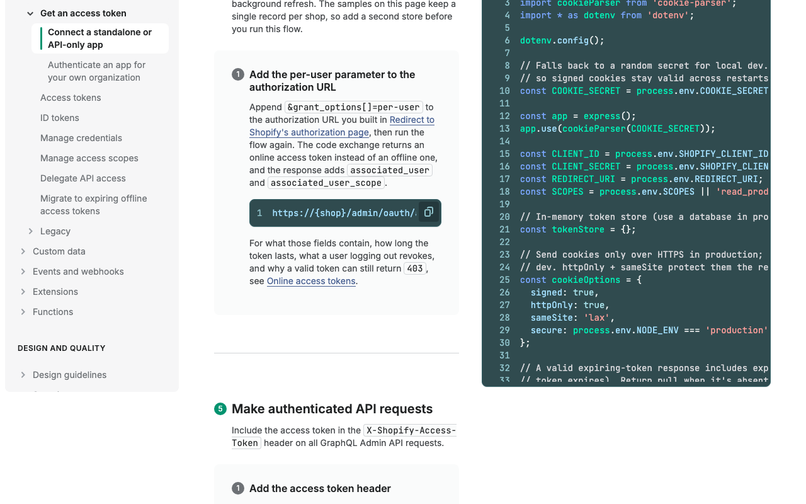
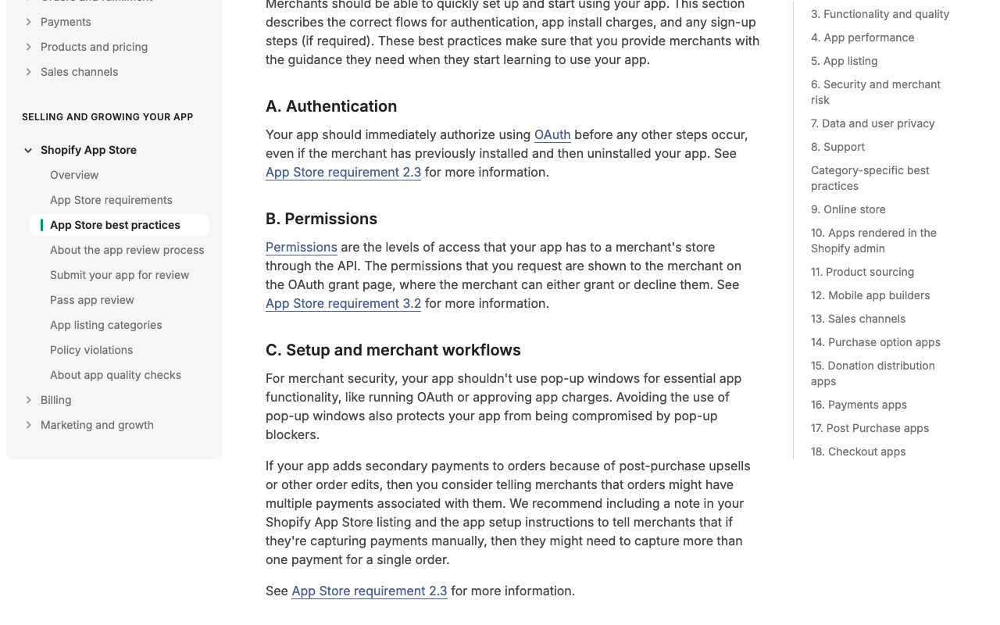

# Shopify: create a Dev Dashboard app for Composio

Captured 2026-10-21 in public mode (no sign-in). **Tier: instant for custom distribution, reviewed for public distribution.** Custom apps need no approval; public apps must pass Shopify app review before merchants can install them. About 10 to 15 minutes of human time for the app itself, plus an unknown review wait if you go public.

Labels: **TESTED** = seen in the browser during this capture. **DOCS** = Shopify's docs, with the quote checked on the live page. **UNCERTAIN** = not checked in this run.

## 1. Sign in to the Dev Dashboard · human (credential) · TESTED
`https://dev.shopify.com/dashboard` sends you to Shopify's sign-in. It asks for an email first, with password, passkey, Google, Apple, Facebook and WhatsApp options. No bot check or cookie banner showed up.

## 2. Create the app · human · DOCS
In the Dev Dashboard, go to Apps, select Create app, choose Start from Dev Dashboard, name the app and select Create. You need to be a user with app development permissions. Shopify's docs add that for an app-store app you should build with Shopify CLI instead.

## 3. Create a version · agent prepares, human types · DOCS
An app must have at least one version before it can be installed. Fill in the App URL (for a non-embedded app the default `https://shopify.dev/apps/default-app-home` works), the Webhooks API version and the Scopes, then select Release. Scope changes later are not applied to installed stores until the merchant approves them.

## 4. Add Composio's callback as the redirect URL · agent prepares, human types · DOCS
Paste `https://backend.composio.dev/api/v3/toolkits/auth/callback`, or better, the exact value shown in your Composio auth config. Shopify says the `redirect_uri` must exactly match one you configured in the Dev Dashboard, so there is no room for a near miss. Where this field sits in the Dev Dashboard form was not seen (UNCERTAIN).

## 5. Redirect URL requirement for public apps · DOCS
You must include at least one redirect URL before making your app public. This line is from the Shopify CLI configuration reference, so treat it as a rule for the app config, not a screenshot of the dashboard. The separate page of redirect URL rules was not captured.

## 6. Choose public or custom distribution · human · DOCS
You can't change the distribution method after you select it. Public distribution (many stores) needs approval; custom distribution (one store, stores in the same Plus organization, or development stores) does not. Where this choice is made in the dashboard was not seen (UNCERTAIN).

## 7. Public apps: submit for app review and wait · human (wait) · DOCS
A public app goes through Shopify's app review. Statuses run Draft, Submitted, Reviewed, Published, and the requirements are the same for fully visible and limited visibility apps. No review time was stated on the captured page.

## 8. Copy Client ID and Client secret into Composio · human (credential) · DOCS
In the app, open App settings and copy the Client ID and Client secret, then paste them into a Composio auth config. No screenshot: that screen needs sign-in.

## 9. What happens at runtime: a per-shop authorize URL · DOCS
Shopify's authorize URL is `https://{shop}/admin/oauth/authorize?client_id={client_id}&scope=...&redirect_uri=...&state=...`, on the merchant's own shop domain. So each end user has to supply their shop. The callback `shop` value must match `*.myshopify.com`. New public apps must use expiring offline access tokens.

## 10. Authorize immediately on install · DOCS
Shopify's best practices say the app should immediately authorize using OAuth before any other steps occur, even if the merchant has installed and uninstalled before. This is phrased as a "should" for App Store apps.

