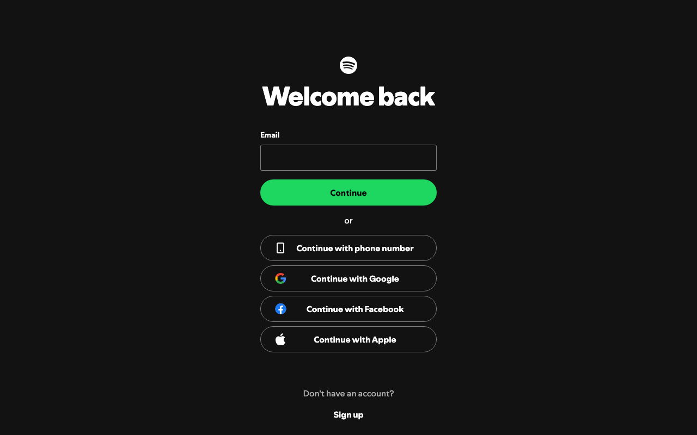
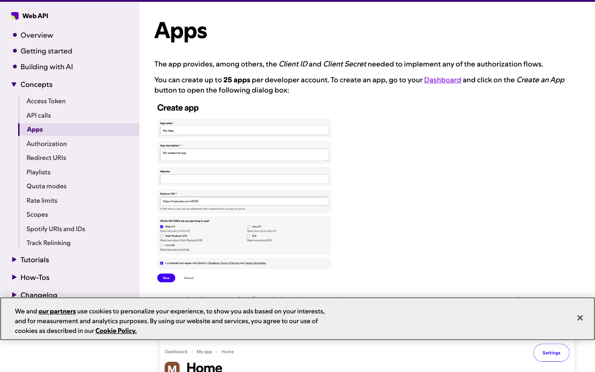
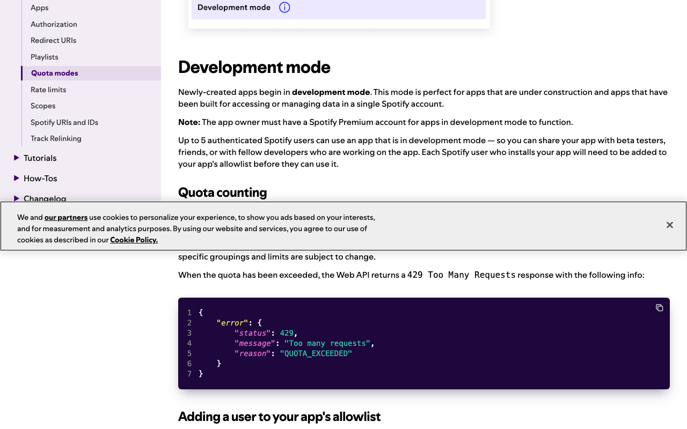
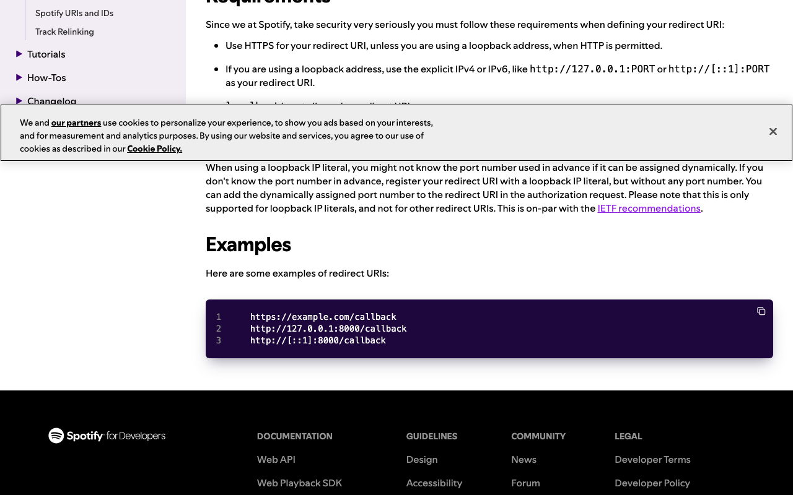
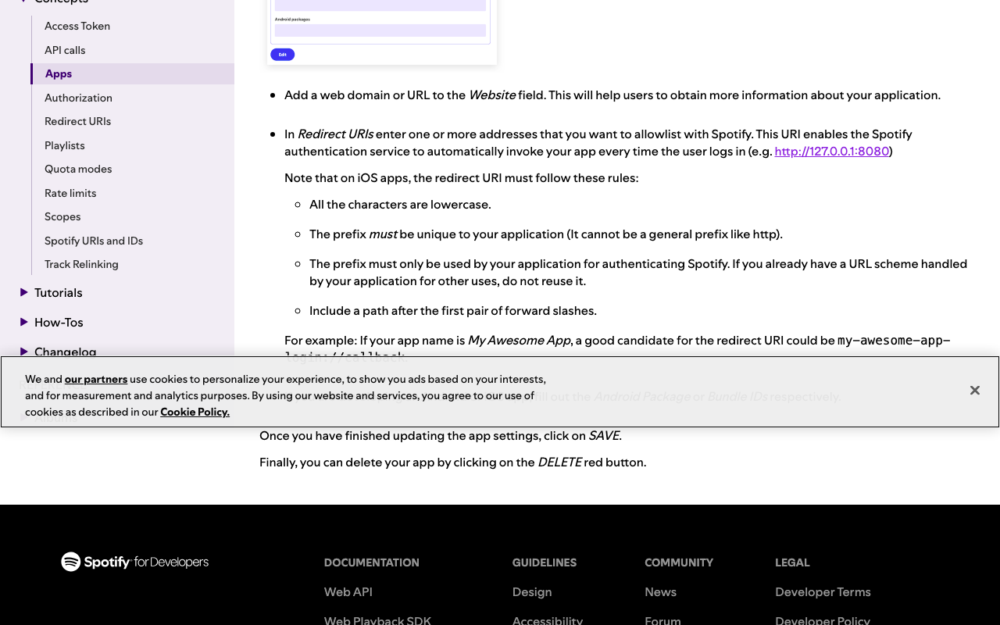
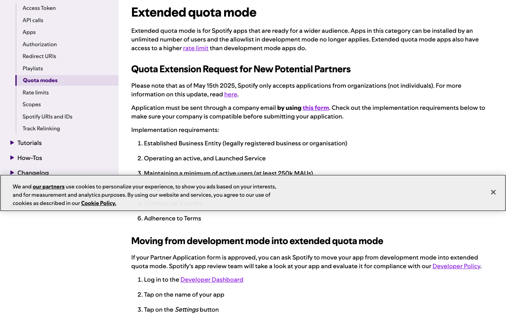

# Spotify: create a Web API app for Composio

Captured 2026-10-21 in public mode (no sign-in). **Tier: instant to create, but capped.** Creating the app takes minutes and needs no review. The catch is the limits: a development-mode app works for at most 5 allowlisted users, and the owner needs Spotify Premium. Wider use needs an extended-quota application, which is for organizations only.

Labels: **TESTED** = seen in the browser during this capture. **DOCS** = Spotify's docs, with the quote checked on the live page. **UNCERTAIN** = not checked in this run.

## 1. Sign in to Spotify · human (credential) · TESTED
The dashboard URL sends you to Spotify's login. Options are email, phone, Google, Facebook or Apple. The page mentions reCAPTCHA. Use the account that will own the app, and make sure it has Premium (step 3).

## 2. Open the Dashboard and click Create an App · human · DOCS
You can create up to 25 apps per developer account. The docs show the Create app dialog below. Anything extra on a first visit, such as developer terms or email checks, wasn't seen.

## 3. Check the owner has Spotify Premium · human (payment) · DOCS
"The app owner must have a Spotify Premium account for apps in development mode to function." Whether the dashboard blocks creation for a Free account is UNCERTAIN.

## 4. Fill in name, description and website · agent prepares, human types · DOCS
The name and description are shown to users on the grant screen, so write them for your customers.

## 5. Set the Redirect URI to Composio's · agent prepares, human types · DOCS
Paste `https://backend.composio.dev/api/v3/toolkits/auth/callback`, or better, the exact value shown in your Composio auth config. Spotify requires an exact match. HTTPS is accepted. `localhost` is not allowed; for local testing use `http://127.0.0.1:PORT` or `http://[::1]:PORT`. The cookie banner covers the localhost bullet in this screenshot, but the quote was verified on the live page.

The Edit Settings section of the Apps page covers the Website and Redirect URIs fields after creation:

## 6. Tick Web API, accept the terms, click Save · human (legal acceptance) · DOCS
The docs text says "CREATE" while the docs image shows "Save", so expect either label. The app starts in development mode with no approval step.

## 7. Know the development-mode limits · DOCS
Up to 5 authenticated Spotify users can use the app, and each must be added to the allowlist (Dashboard > app > Settings > Users Management > Add new user). Quota limits also apply and return 429 QUOTA_EXCEEDED.

## 8. Copy the Client ID and Client Secret into Composio · human (credential) · DOCS
They are on the app overview page. The docs say you can regenerate the secret with the ROTATE button. The overview page was not seen, since it needs sign-in.

## 9. Optional: extended quota · human (submit) · DOCS
Spotify only accepts applications from organizations, not individuals. Requirements include at least 250k monthly active users, and review can take up to six weeks. Most Composio users will stay in development mode.

