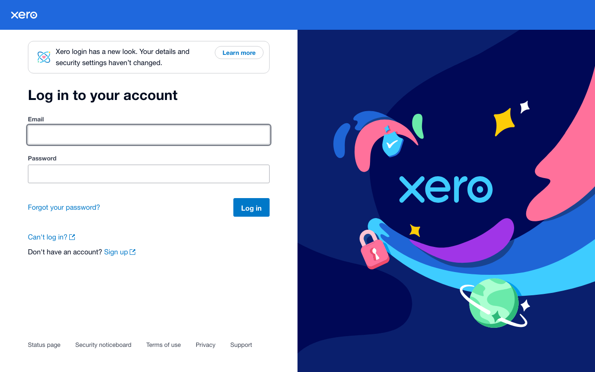
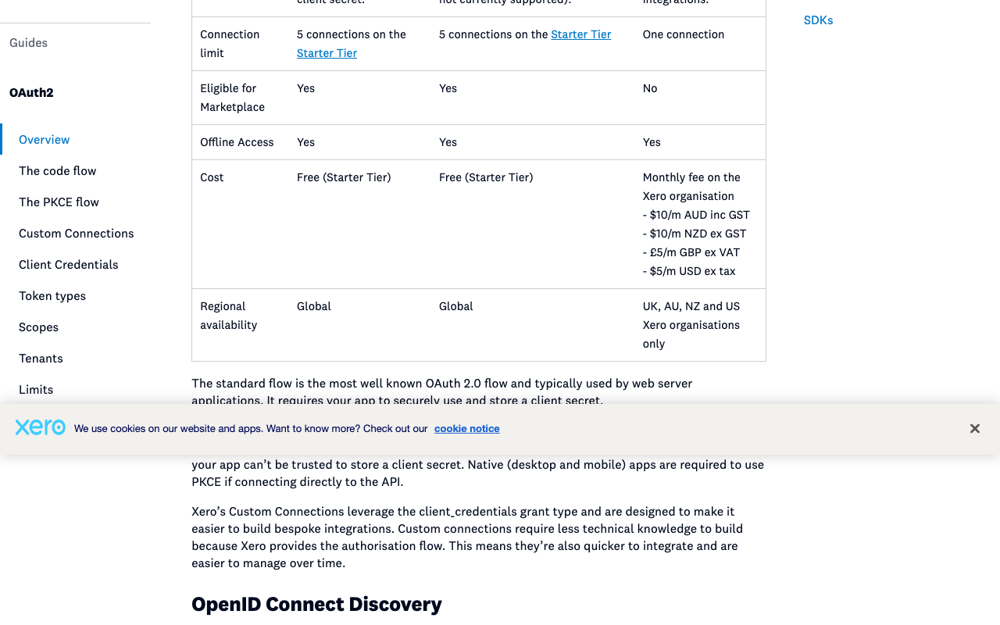
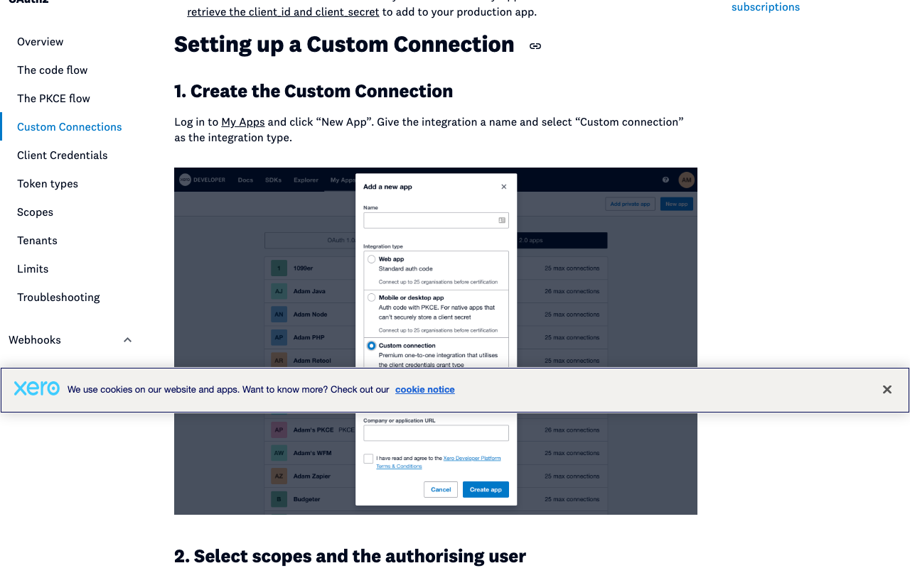
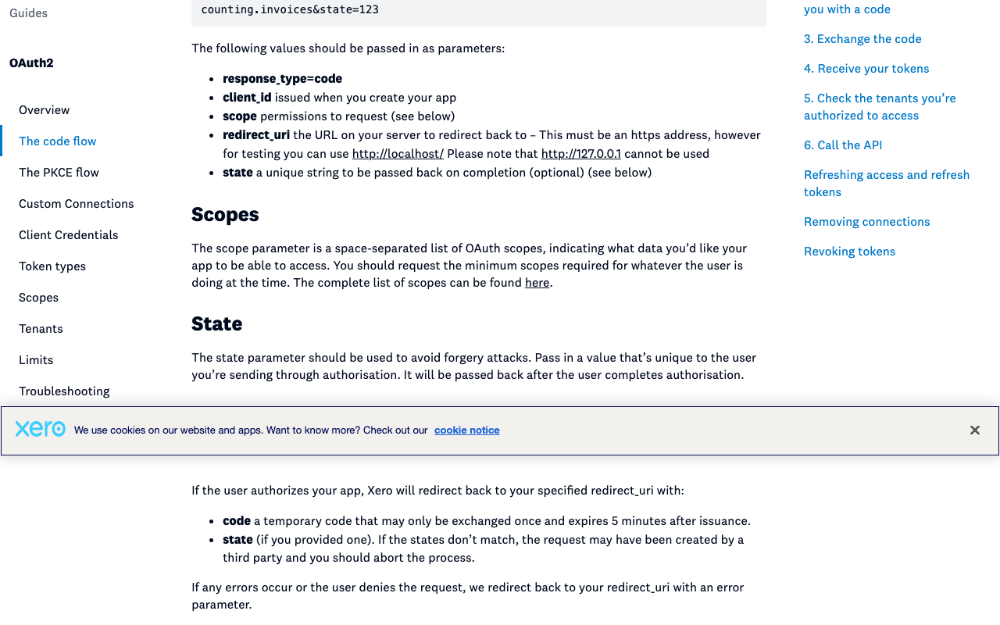
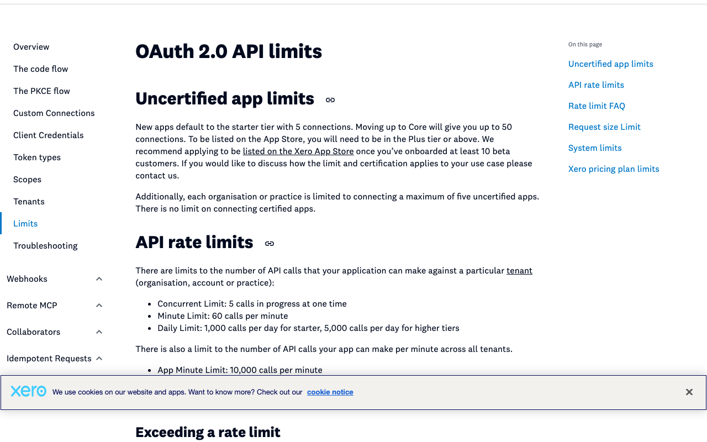
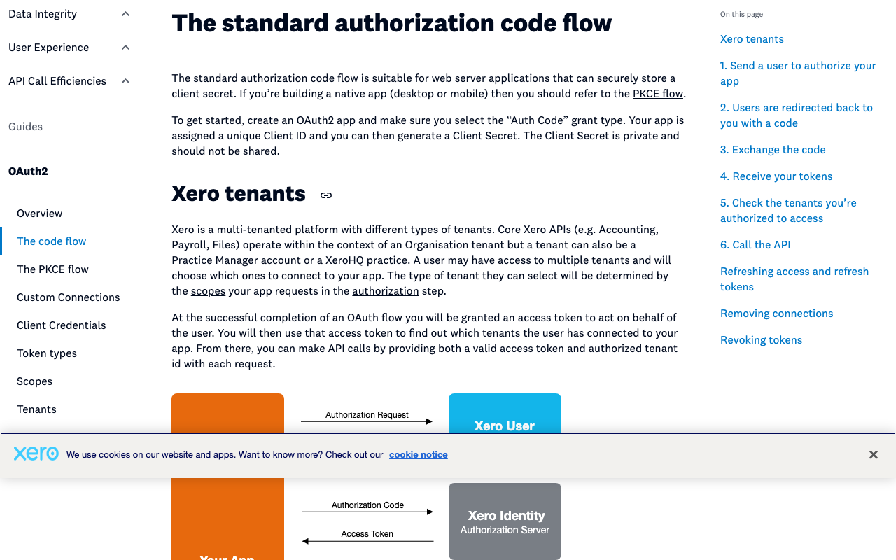

# Xero: create an OAuth 2.0 app for Composio

Captured 2026-10-21 in public mode (no sign-in). **Tier: instant to create, but capped.** No review or approval to create the app. About 5 to 10 minutes of human time. New apps start on the Starter Tier with 5 connections, and a Xero organisation can connect at most 5 uncertified apps.

Labels: **TESTED** = seen in the browser during this capture. **DOCS** = Xero's docs, with the quote checked on the live page. **UNCERTAIN** = not checked in this run.

## 1. Log in to Xero · human (credential) · TESTED
The developer portal's My Apps page (`https://developer.xero.com/app/manage`) redirects to the Xero login. It asks for an email and password, with a Sign up link if you have no Xero account. No bot check or cookie banner on this page.

## 2. Pick the app type · agent or human · DOCS
Xero has three types, named by grant type. For Composio's server-side flow use the standard code flow ("Auth Code"). Code flow and PKCE both allow 5 connections on the free Starter Tier. PKCE gives no client secret, and single page apps are not supported. A Custom Connection is one organisation only, is not eligible for the Marketplace, and costs a monthly fee on the Xero organisation (for example $5 USD or $10 AUD).

## 3. Create the app · human (legal acceptance) · DOCS
In My Apps, click New app, enter a name, choose the integration type, add a company or application URL, tick the developer terms checkbox and click Create app. The picture below is an image from Xero's Custom Connections docs, not the live form. It looks older than the text: it says 25 organisations before certification, while the current text says 5.

## 4. Set the redirect URI to Composio's · agent prepares, human types · DOCS
Paste `https://backend.composio.dev/api/v3/toolkits/auth/callback`, or better, the exact value shown in your Composio auth config. Xero requires https (http://localhost is allowed for testing, http://127.0.0.1 is not). Custom URL schemes are not supported. Where the field sits in the portal was not seen in this run.

## 5. Know the limits · DOCS
New apps are on the Starter Tier with 5 connections. Core allows up to 50. Each Xero organisation or practice can connect at most five uncertified apps, with no limit on certified ones. Custom Connection apps do not count toward that five.

## 6. Request offline_access · agent or human · DOCS
Xero only returns a refresh token if the offline_access scope is requested. Access tokens last 30 minutes and refresh tokens 60 days.

## 7. Generate a client secret and add the ID and secret to Composio · human (credential) · DOCS
The docs say the app gets a Client ID and you then generate a Client Secret. The real button was not seen. Do not choose PKCE if you need a secret.

